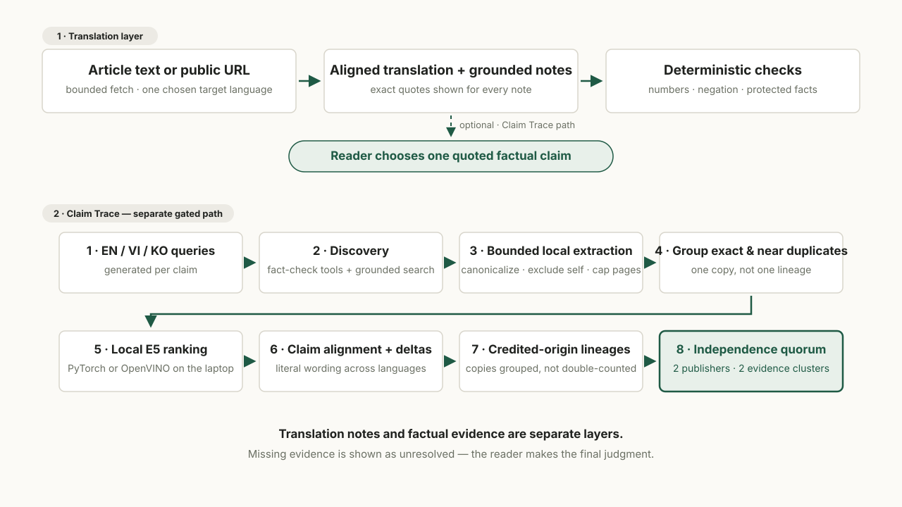

# Between the Lines

A trilingual news reader for English, Vietnamese, and Korean.

Paste an article or provide a public URL.
The reader aligns one translation with the source, keeps language notes attached to exact spans, and checks protected facts such as numbers and negation.

An optional reviewer-gated Claim Trace prototype searches across all three languages, keeps provenance visible, and records wording differences and partial failures.
It remains hidden from the ordinary reading flow until its factual and reader gates pass.

## Boundaries

- Source text and selected evidence excerpts may be sent to Gemini
- Local ranking, analysis, cached results, and feedback stay in local SQLite
- Model notes appear only when their quoted spans resolve
- Claim Trace is a controlled prototype, not validated factual accuracy

[Run, verify, configure, and inspect the current evidence](GUIDE.md).

- [Evaluation report](submission/evaluation-report.md)
- [Responsible AI notes](submission/responsible-ai.md)
- [Demo script](submission/demo-script.md)
